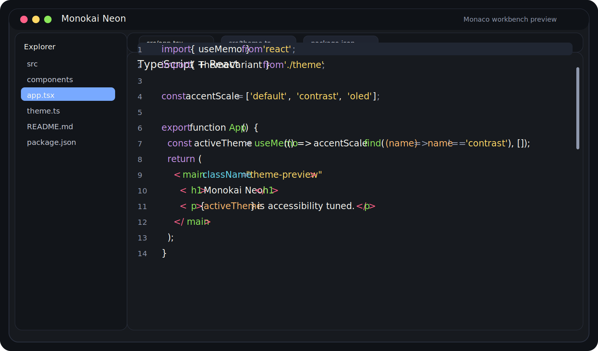
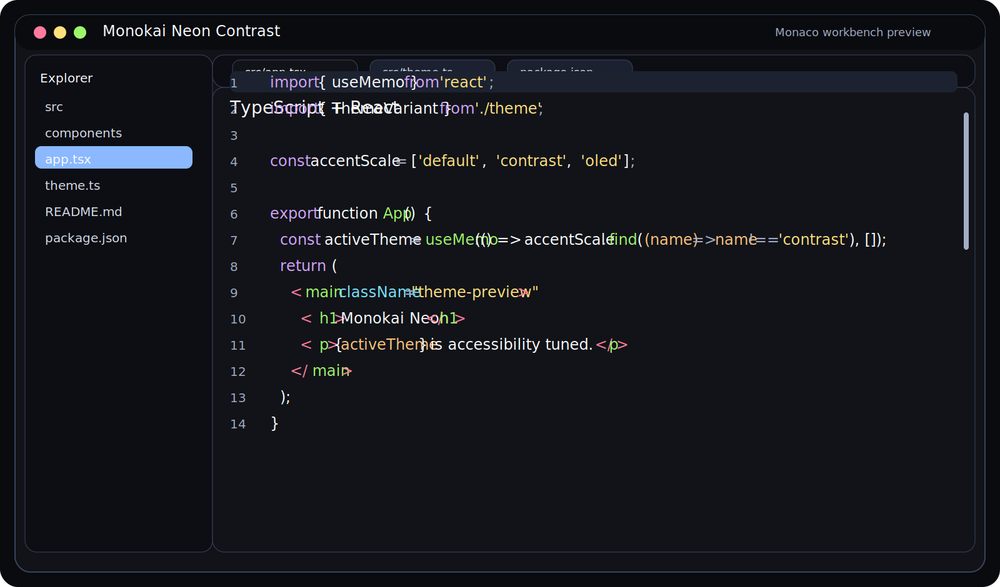
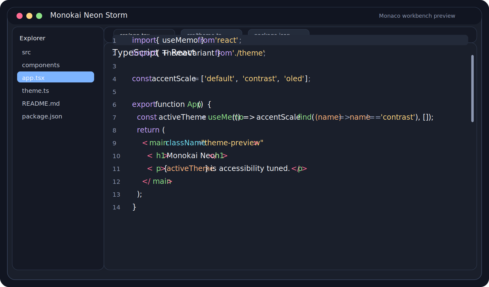
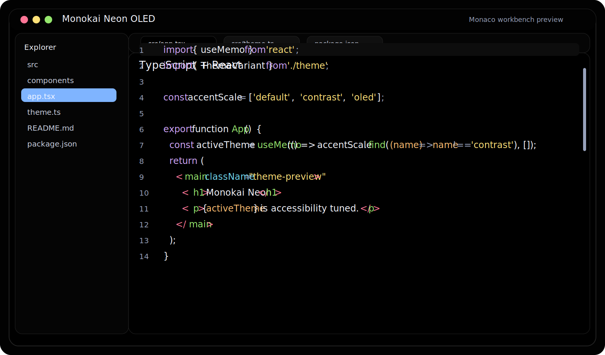
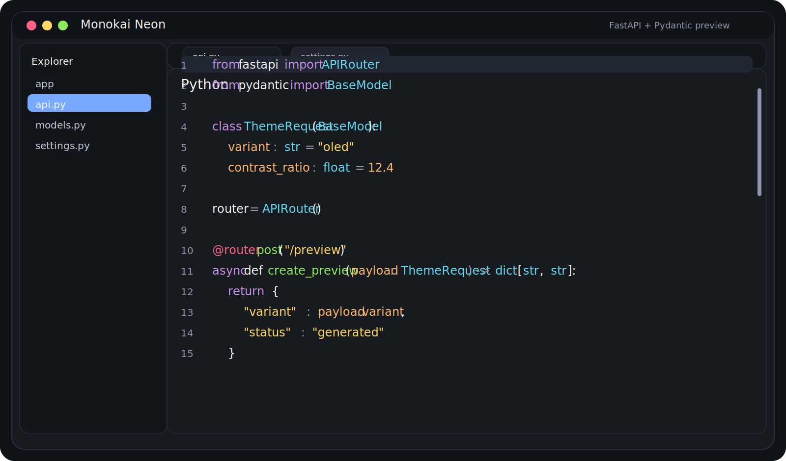
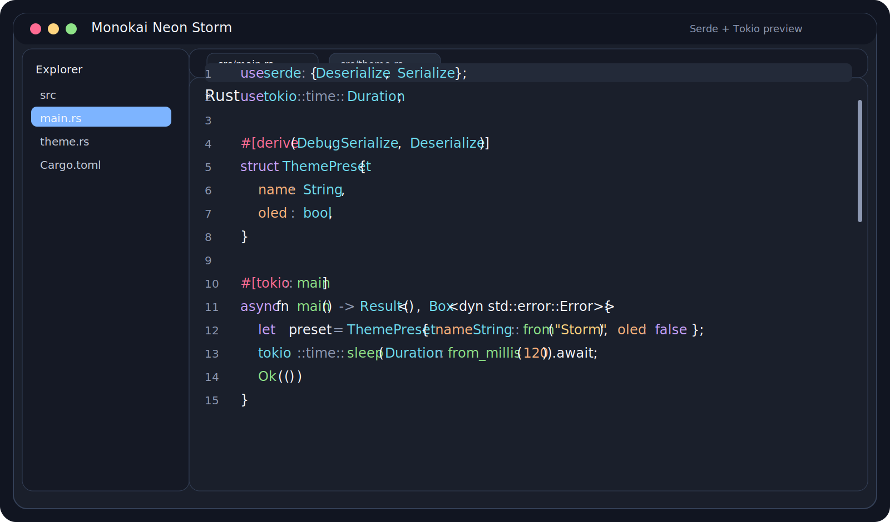
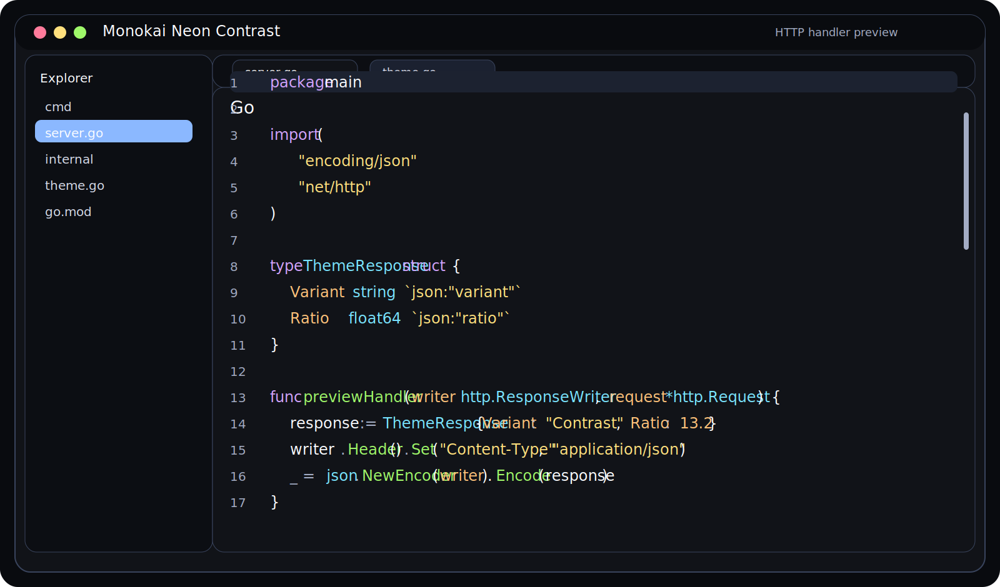
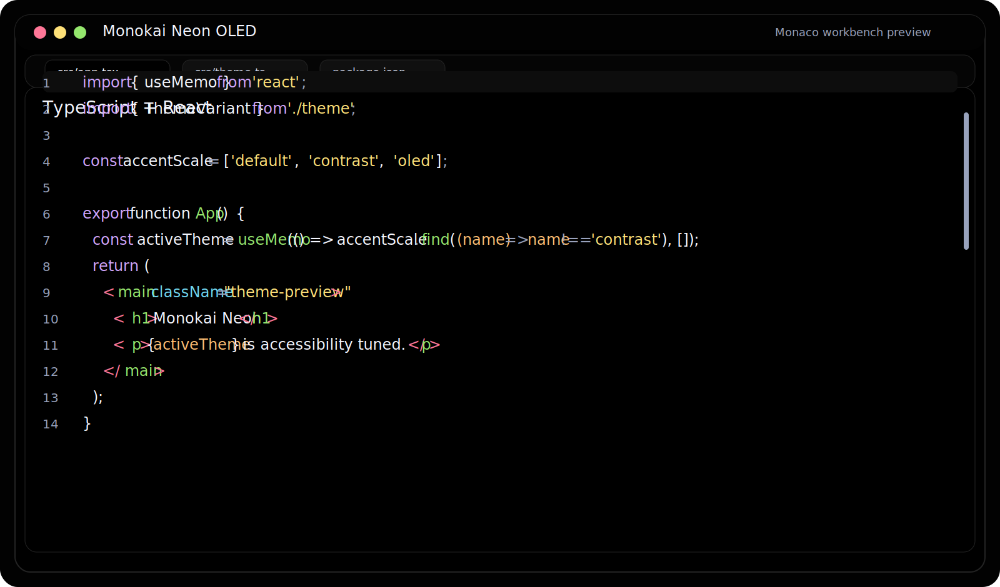

# Monokai Neon

A rebuilt Monokai-inspired VS Code theme suite with source-generated themes, broader language-specific syntax coverage, and release automation modeled after the workflow used in the Catppuccin VS Code project.

## Theme lineup

| Theme | Purpose | Editor background | Notes |
| --- | --- | --- | --- |
| `Monokai Neon` | Balanced default | `#171a1f` | Bright neon accents with a comfortable dark workbench |
| `Monokai Neon Contrast` | Higher contrast | `#111318` | Brighter guides, stronger text contrast, clearer inactive UI states |
| `Monokai Neon Storm` | Cooler slate variant | `#1a1f2b` | A calmer blue-slate workbench with vivid syntax accents |
| `Monokai Neon OLED` | Pure black OLED mode | `#000000` | True black background with softened neon to reduce bloom on OLED screens |

## Accessibility snapshot

Contrast ratios were checked for the main text surfaces used in each theme variant. The generated source of truth lives in [`assets/accessibility-report.json`](./assets/accessibility-report.json).

| Theme | Editor text | Comments | Sidebar text | Status bar text |
| --- | ---: | ---: | ---: | ---: |
| Monokai Neon | 16.36 | 4.99 | 11.29 | 17.60 |
| Monokai Neon Contrast | 18.11 | 7.37 | 14.09 | 19.20 |
| Monokai Neon Storm | 15.39 | 5.15 | 11.24 | 17.01 |
| Monokai Neon OLED | 19.63 | 7.37 | 13.60 | 19.40 |

## Interface previews

<p align="center">
  
</p>

<details>
<summary>More workbench variants</summary>

| Contrast | Storm |
| --- | --- |
|  |  |

| OLED |
| --- |
|  |

</details>

## Syntax previews

### TypeScript / React


### Python



### Rust



### Go



### OLED editor sample



## Language-specific theming coverage

The generated themes intentionally target both TextMate scopes and semantic tokens so that major languages remain consistent even when semantic highlighting is enabled. Coverage includes:

- JavaScript / TypeScript / TSX / JSX
- Python
- Go
- Rust
- HTML / CSS / Markdown
- JSON / YAML
- Shell scripts and diffs
- Common semantic token classes for classes, interfaces, enums, functions, methods, properties, parameters, decorators, labels, regexes, comments, numbers, and keywords

Recommended editor settings:

```jsonc
{
  "editor.semanticHighlighting.enabled": true,
  "terminal.integrated.minimumContrastRatio": 1,
  "window.titleBarStyle": "custom"
}
```

## Development

The repo now uses a source-first workflow. Edit the generation script and then regenerate the committed outputs.

```bash
npm run build
npm run check
npm run package -- --allow-missing-repository
```

What each command does:

- `npm run build` regenerates all committed theme JSON files and preview SVGs.
- `npm run check` fails if generated files are stale.
- `npm run package -- --allow-missing-repository` rebuilds and packages the extension with `@vscode/vsce`.

## Publishing, versioning, and changelogs

This repository now follows the same high-level release pattern used by Catppuccin's VS Code theme repo:

1. Merge changes into `main` using clear commit messages.
2. The `release-please` workflow opens or updates a release PR.
3. When that PR is merged, it updates `package.json`, tags the release, and writes the next changelog section in `CHANGELOG.md`.
4. Publishing happens from the GitHub Release event in `.github/workflows/publish.yml`.

### GitHub Actions added in this rebuild

- `.github/workflows/ci.yml` — regenerates assets, checks generated files, and packages a VSIX artifact.
- `.github/workflows/release-please.yml` — manages changelog + version bump PRs.
- `.github/workflows/publish.yml` — packages the extension, uploads the VSIX to the GitHub Release, publishes to Open VSX, and publishes the npm package.

### Required GitHub Actions secrets and environment variables

| Name | Type | Required | Used for |
| --- | --- | --- | --- |
| `OPEN_VSX_TOKEN` | Repository secret | Yes | `ovsx publish` to the Open VSX registry |
| `NPM_TOKEN` | Repository secret | Yes for this workflow | `npm publish` to the public npm registry |
| `GITHUB_TOKEN` | Built-in GitHub Actions token | Provided automatically | Uploading VSIX files to GitHub Releases and creating release PRs |

#### Do you need an npm token?

Yes — with the workflow currently included in this repo, you should create an npm automation or granular publish token and save it as `NPM_TOKEN`.

Notes:

- `monokai-neon` does not currently appear to be claimed on npm, but you should confirm the package name you want before the first publish.
- If you prefer npm trusted publishing later, you can replace `NPM_TOKEN` with an OIDC-based setup, but that is **not** what this repository is wired for right now.
- You do **not** need any additional secret beyond `OPEN_VSX_TOKEN` and `NPM_TOKEN` for the workflows currently committed here.
- If you decide to publish to the Microsoft VS Code Marketplace later, add a separate secret such as `VS_MARKETPLACE_TOKEN` and an additional publish step.

## Manual installation

- Open VS Code
- Open the command palette
- Run `Extensions: Install from VSIX...`
- Pick the built artifact from `npm run package`

## npm package usage

The npm package ships the generated theme JSON files so they can be reused outside VS Code tooling.

```js
import theme from 'monokai-neon/theme' assert { type: 'json' };
```

Available exports:

- `monokai-neon/theme`
- `monokai-neon/theme/contrast`
- `monokai-neon/theme/storm`
- `monokai-neon/theme/oled`
