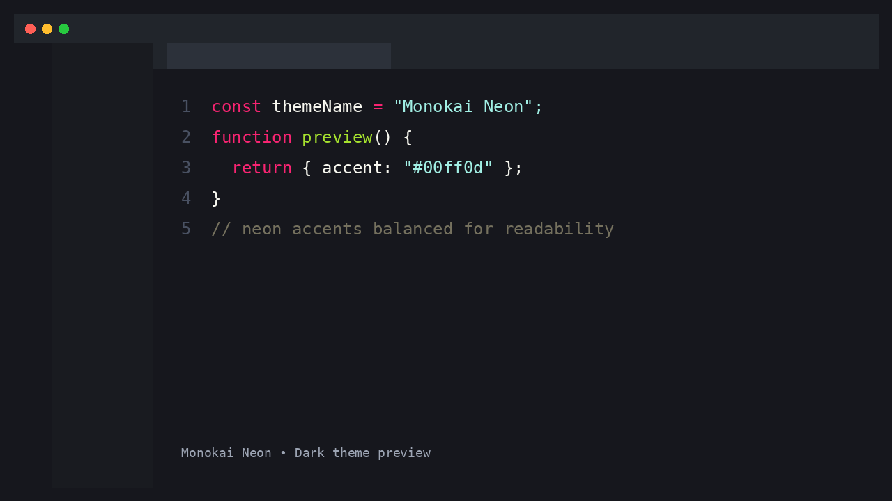
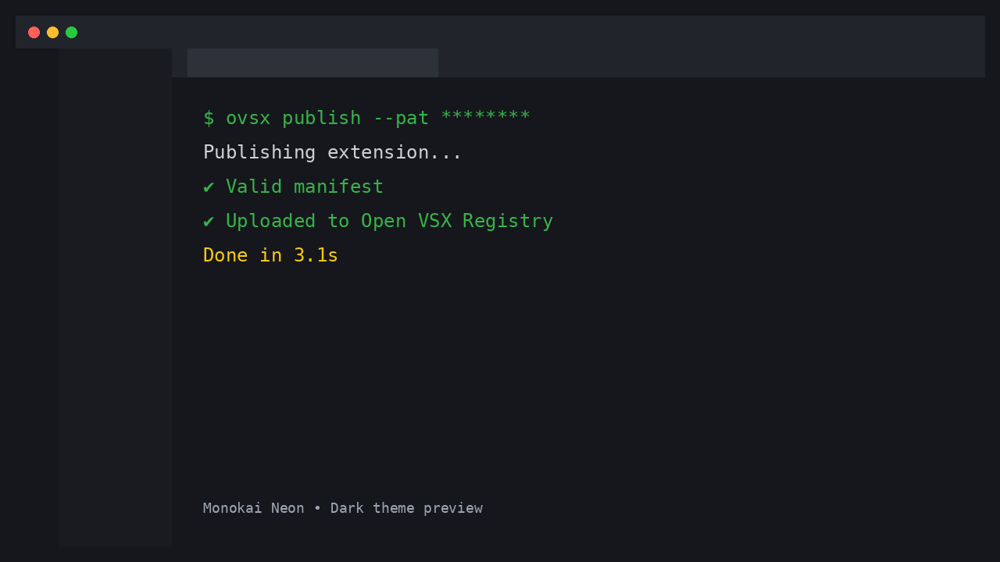

# Monokai Neon

A modernized **Monokai-inspired neon dark theme** for VS Code focused on strong readability in both bright and dark environments.


## Preview

### Editor


### Terminal


## Install

### Visual Studio Marketplace
Install from the Marketplace: <https://marketplace.visualstudio.com/items?itemName=ryolambertdev.monokai-neon>

### Open VSX Registry
Install from Open VSX: <https://open-vsx.org/extension/ryolambertdev/monokai-neon>

### Manual
```bash
pnpm package
code --install-extension monokai-neon-*.vsix
```

## Development

```bash
pnpm install

# Package extension locally
pnpm package

# Publish manually (requires tokens)
pnpm publish:vscode
pnpm publish:openvsx
```

## Automatic publishing (GitHub Actions)

This repository includes a workflow at:

- `.github/workflows/publish.yml`

It publishes on pushed tags matching `v*` (for example: `v0.0.2`) and can also be run manually.

### Required repository secrets

- `VSCE_PAT`: Visual Studio Marketplace publisher token
- `OVSX_PAT`: Open VSX access token

If a secret is missing, that publish step is skipped.

## Release process (merge-driven)

Publishing now runs automatically on pushes to `main` (including PR merges), but only when both of these are true in the merged commit:

1. `package.json` version is bumped
2. `CHANGELOG.md` is updated

This prevents accidental republishing when non-release PRs are merged.

### Required secrets

- `OVSX_PAT` (**required for Open VSX publishing**)
- `VSCE_PAT` (optional; required only if you also want VS Marketplace publishing)

If `OVSX_PAT` is not set, Open VSX publish is skipped.

## Open VSX publisher agreement checklist

To keep the extension listed in Open VSX, ensure your publisher account has completed the Eclipse Publisher Agreement process:

- <https://www.eclipse.org/legal/documents/eclipse-openvsx-publisher-agreement.pdf>
- <https://github.com/eclipse/openvsx/wiki/Publishing-Extensions>
- <https://github.com/eclipse/openvsx/wiki/Namespace-Access>

## License

[MIT](./LICENSE)
